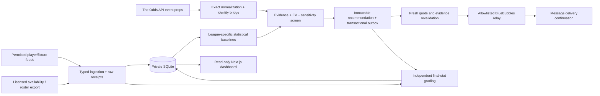

# Standalone architecture

Node 24 runs two independent processes. SQLite is private, local, transactional and shared through WAL; the dashboard uses read-only database connections. No old project import, service dependency, SDK credential or financial schema is retained.

## Modules

| Module | Responsibility |
| --- | --- |
| `src/core/domain.ts` | Runtime schemas, nullability, exact selection keys, mapping proofs, clocks and push-aware EV |
| `src/providers/http.ts` | Fixed provider origins, redacted diagnostics, bounded timeout, raw bytes, TTL cache and pre-request quota reservations |
| `src/providers/balldontlie.ts` | Paid-entitlement gate, games/stats joins, resumable pagination, missing-minute preservation, injury read port |
| `src/providers/import.ts` | Explicit permitted normalized feed/export contract; source bytes and simulation boundaries |
| `src/providers/identity.ts` | Exact fixture and event-scoped player bridges; no fuzzy player matching |
| `src/providers/odds.ts` | NBA/NBL event-level four-market odds, Sportsbet attribution and original market timestamps |
| `src/core/models.ts`, `evaluation.ts` | Count distributions, empirical/minutes bootstrap, chronological candidate selection and held-out scoring |
| `src/core/screen.ts` | Conservative freshness, availability, terms, sample, EV and robustness requirements |
| `src/core/store.ts` | SQLite transactions, raw bodies and exact fetch receipts, fenced leases, immutable signals, outbox and grade revisions |
| `src/core/worker.ts` | Independent scanner, checkpoints, adaptive research windows, result ingestion and dispatch |
| `src/core/messaging.ts` | Replaceable transport, deterministic explanations, destination verification, submission/delivery distinction and crash reconciliation |
| `src/core/settlement.ts` | Exact final statistics, void/push rules, append-only corrections, full-sample performance and calibration |
| `src/core/snapshot.ts`, `src/app` | Read-only projection, league/market filters, automatic performance and operational diagnostics |

## Stored evidence and atomicity

Bodies are content addressed with SHA-256. A separate immutable receipt table preserves each provider/endpoint/retrieval/publication/simulation tuple even when identical bytes are returned at different times. A fresh retrieval never rewrites an older receipt. Cache hits keep the original retrieval time. Supporting fixture receipts remain attached to player-stat records.

Training facts have player/event/source keys. Repeated pages do not duplicate a statistical label; later corrections are separate revisions. Live fitting chooses the latest revision known by its cutoff, never a revision first fetched after that cutoff. Missing end times stay null; first observed final availability is explicit. Date-only starts are quarantined.

A recommendation freezes its exact quote, mapping proof, model inputs and hash, version, availability context, terms, validation manifest and pre-event clock. Signal insertion and pending outbox insertion share one immediate transaction. SQL triggers prevent signal mutation or selective deletion. No record asserts that the owner placed anything.

Final grades are independent source observations after tip-off. Corrections append a new outcome with a link to the previous grade; reporting uses the latest verified grade while retaining the original. A replay of the same outcome does nothing. All losing recommendations remain in the denominator.

Research and delivery use separate database leases with token fencing. A crashed research process can be replaced after its lease expires. Delivery claims are committed before transport; an interrupted send is uncertain rather than eligible for blind retry. BlueBubbles can recover an exact outgoing text/GUID from the verified chat. No match or ambiguous matches remain uncertain.

## Autonomous operation boundaries

The engine decides whether to issue and send a signal without owner confirmation. Quality gates are technical requirements, not a bet acceptance workflow. Live source accounts, usage allowance, provider permission, current roster/availability, terms and validated league/market models must exist first.

The shipped BDL adapter automates game/stat acquisition and can veto known injuries. Absence from an injury list is never proof of availability. A permitted positive availability/roster feed must continuously populate the normalized evidence contract; this connector and a licensed NBL feed cannot be validated without access. Fixture/player bridges must be generated from exact provider IDs by that source integration. The scanner records unknown catalogue fixtures and never guesses their mappings.

## Host migration

An always-on Linux host can run the same headless worker with its own private persistent SQLite volume, Node 24 and a process supervisor. Keep a single active research/delivery owner of a database and quota account. Separate copies of SQLite do not coordinate leases: never dual-run a copied store. A remote worker may call an authorised awake macOS BlueBubbles relay over HTTPS. Use a private tunnel or firewall and dedicated secret; do not expose the dashboard or Apple credentials.

This repository prepares LaunchAgent and systemd templates but installs neither. A hosted multi-worker deployment should replace the repository/lease/quota implementation with a transactional shared database and retain the same ports and immutable records. A static/cloud dashboard needs an authenticated read API; publishing a snapshot does not create an always-on worker.
